<div align="center">


`2º DAW · EIG Granada` &nbsp;·&nbsp; `Huétor Tájar, Granada` &nbsp;·&nbsp; `presencial · híbrido · remoto`

[Portfolio](https://antoniocantonsanz.github.io/Antairon.dev) &nbsp;|&nbsp; [LinkedIn](https://www.linkedin.com/in/antonio-canton-sanz)

</div>

<br>

<p align="center">
  
</p>

<p align="center"><sub>Me gusta convertir tareas manuales en cosas que funcionan solas. Trabajo con agentes de IA, pero planifico, reviso cada paso y no entrego nada que no sepa explicar.</sub></p>

### ⚡ Herramientas

<p align="center">
  
</p>

<p align="center"><sub>Y para automatizar: <b>Make</b> · <b>n8n</b> · <b>Apify</b> · <b>Notion API</b> · <b>Claude Code</b> · <b>GitHub Copilot</b></sub></p>

### 🧭 Recorrido

```
2025 ─┬─ Empiezo DAW (FP Dual) en EIG Granada
      │
2026 ─┼─ Mayo · Prácticas en Flores Torrecillas
      │    automatizamos la búsqueda de clientes con Make, Apify e IA
      │    CRM con la API de Notion · n8n desplegado por SSH
      │
      ├─ Octubre · Simulación de Release Manager
      │    QA → UAT → producción en Vercel, CI y SemVer
      │
2027 ─┴─ Febrero · Prácticas FCT ← aquí estoy buscando sitio
```

### 🛠️ Proyectos

<table>
  <tr>
    <td width="50%" valign="top">
      <h4>🚦 <a href="https://github.com/AntonioCantonSanz/practica-release-manager">Release Manager</a></h4>
      Ramas QA → UAT → producción desplegadas solas en Vercel. La app detecta su entorno por la rama, hay CI en cada push y versiones con changelog.<br><br>
      <code>Angular</code> <code>GitHub Actions</code> <code>Vercel</code><br>
      <a href="https://practica-release-manager.vercel.app">▶ Ver demo</a>
    </td>
    <td width="50%" valign="top">
      <h4>🎃 <a href="https://github.com/AntonioCantonSanz/practica-angular">Noches de Pesadilla</a></h4>
      Cartelera de cine de terror hecha con un agente de IA. Revisamos su plan, lo pasamos a 15 tareas y validamos cada una antes de seguir. Con Pablo Enrique.<br><br>
      <code>Angular</code> <code>TypeScript</code> <code>Copilot</code>
    </td>
  </tr>
  <tr>
    <td width="50%" valign="top">
      <h4>🌸 Automatización comercial</h4>
      Prácticas en un mayorista de flores: de una hoja de cálculo a correos personalizados por IA, sin tocar nada a mano. Presentado a gerencia. <i>Código privado.</i><br><br>
      <code>Make</code> <code>Apify</code> <code>Groq</code> <code>Notion API</code>
    </td>
    <td width="50%" valign="top">
      <h4>🚀 <a href="https://github.com/AntonioCantonSanz/Space-Survival">Space-Survival</a></h4>
      Videojuego 2D de naves para practicar programación orientada a objetos.<br><br>
      <code>Python</code> <code>Pygame</code>
    </td>
  </tr>
  <tr>
    <td width="50%" valign="top">
      <h4>🎰 <a href="https://github.com/AntonioCantonSanz/slot-machine-pirata">Tragaperras Pirata</a></h4>
      Máquina tragaperras con temática pirata que funciona entera en el navegador.<br><br>
      <code>HTML</code> <code>CSS</code> <code>JavaScript</code>
    </td>
    <td width="50%" valign="top">
      <h4>🌐 <a href="https://github.com/AntonioCantonSanz/Antairon.dev">Portfolio</a></h4>
      Mi web personal.<br><br>
      <code>HTML</code> <code>CSS</code><br>
      <a href="https://antoniocantonsanz.github.io/Antairon.dev">▶ Visitar</a>
    </td>
  </tr>
</table>

### 🗣️ Idiomas

🇪🇸 Nativo &nbsp;·&nbsp; 🇬🇧 B2 (EF SET) &nbsp;·&nbsp; 🇫🇷 🇮🇹 Básico

<br>

<div align="center">
  <sub>¿Buscas a alguien para prácticas? Escríbeme por <a href="https://www.linkedin.com/in/antonio-canton-sanz">LinkedIn</a>.</sub>
</div>
